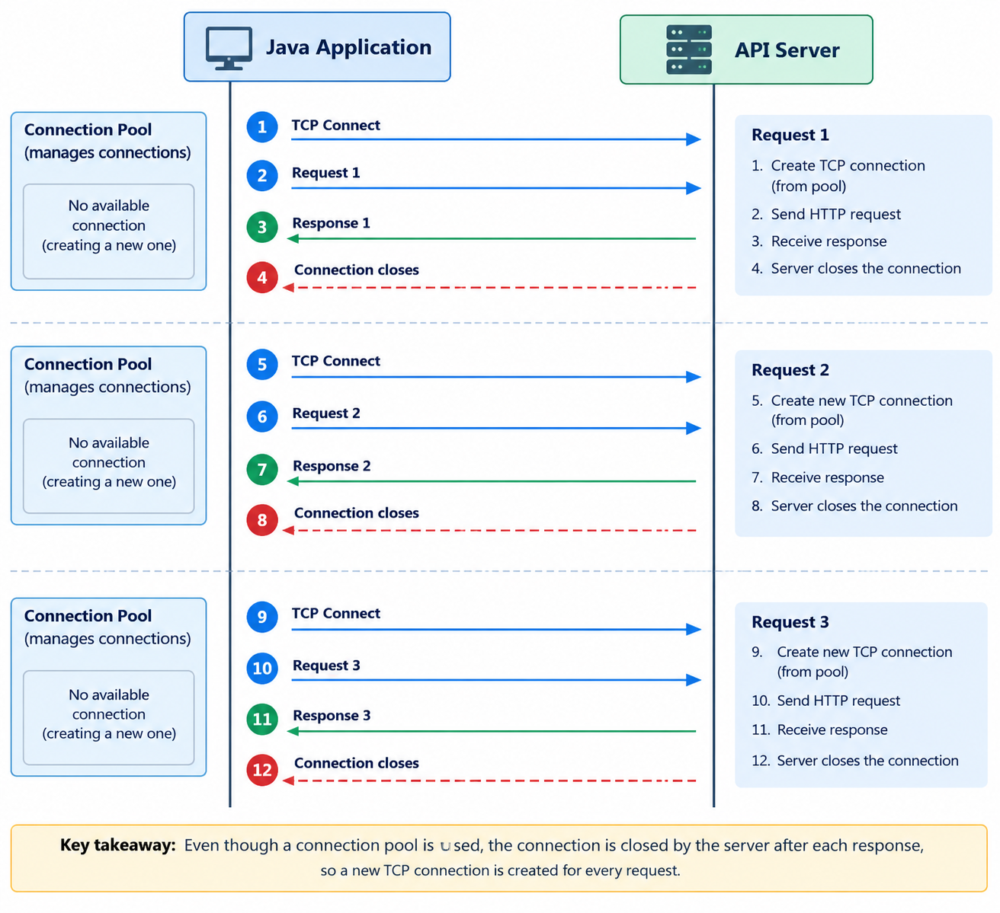
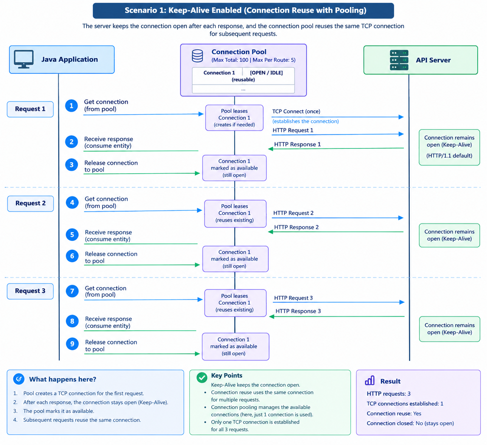

# Apache HttpClient

Apache HttpClient is a Java library for sending HTTP requests to remote servers and processing HTTP responses.

## Table of Contents

- [[#Use Cases]]
- [[#Main Components]]
- [[#HttpEntity]]
- [[#Timeouts]]
- [[#Connection Management]]
- [[#Connection Pooling]]
- [[#Connection Eviction]]
- [[#TLS/SSL Support]]
- [[#Mutual TLS (mTLS)]]
- [[#Authentication]]
- [[#Proxy Support]]
- [[#Retry Strategies]]
- [[#Synchronous vs Asynchronous Execution]]

---

## Use Cases

- Calling REST APIs and OData services
- Communicating with remote systems
- Managing HTTP connections efficiently
- Configuring authentication, TLS, timeouts, and retries

---

## Main Components

| Class | Role |
|---|---|
| `HttpClients` | Provides factory methods to create HTTP clients |
| `HttpClientBuilder` | Configures and builds an HTTP client |
| `CloseableHttpClient` | Executes requests and manages client resources |
| `HttpGet` | Represents a GET request |
| `HttpPost` | Represents a POST request |
| `HttpEntity` | Represents request or response content |
| `RequestConfig` | Configures request-level settings, including timeouts |
| `ConnectionConfig` | Configures connection-level settings |
| `PoolingHttpClientConnectionManager` | Manages a pool of reusable connections |
| `HttpResponse` / `ClassicHttpResponse` | Provides access to response information, including status and headers |

---

## HttpEntity

`HttpEntity` represents the body of an HTTP request or response — the actual content being transferred.

```
HTTP Message
    |
    +---> Headers   (metadata: Content-Type, Content-Length...)
    |
    +---> Entity    (the body: JSON, HTML, binary data...)
```

**On a request** — wraps the data you are sending (e.g. a JSON payload in a POST).
**On a response** — wraps the data the server returned (e.g. HTML, JSON).

### Common Implementations

| Class | Use |
|---|---|
| `StringEntity` | Plain text or JSON string body |
| `ByteArrayEntity` | Raw bytes |
| `FileEntity` | File content |
| `InputStreamEntity` | Stream of data |

### Reading a Response Entity

```java
HttpEntity entity = response.getEntity();

if (entity != null) {
    String body = EntityUtils.toString(entity, StandardCharsets.UTF_8);
}
```

> Always consume the entity (via `EntityUtils.toString()` or `EntityUtils.consume()`) so the connection is returned to the pool.

---

## Timeouts

### HTTP Lifecycle


### Timeout Types

| Timeout | What it guards |
|---|---|
| **Connection-request timeout** | Max time to wait for a connection from the pool |
| **Connect timeout** | Max time to establish a TCP connection to the server |
| **Response timeout** | Max time to wait for the server to start sending a response |
| **Socket/read timeout** | Max time between two consecutive data packets during reading |

### Configuration

```java
RequestConfig config = RequestConfig.custom()
    .setConnectionRequestTimeout(Timeout.ofSeconds(3))   // wait for pool connection
    .setConnectTimeout(Timeout.ofSeconds(5))             // TCP handshake
    .setResponseTimeout(Timeout.ofSeconds(10))           // first byte from server
    .build();

CloseableHttpClient client = HttpClients.custom()
    .setDefaultRequestConfig(config)
    .build();
```

---

## Connection Management

Connection management controls how connections are acquired, used, released, and closed.

```
             HTTP Client
                  |
                  v
           Connection Manager
                  |
        +---------+---------+
        |         |         |
        v         v         v
     Conn 1    Conn 2    Conn 3
        |         |         |
        +---------+---------+
                  |
                  v
             Remote APIs
```

### Connection States

| State | Meaning |
|---|---|
| **Leased** | Currently allocated to a request |
| **Available** | Released and potentially reusable |
| **Pending** | Waiting for a connection to become available |
| **Closed** | No longer usable |

> **Important:** A connection pool and a thread pool are not the same thing. A thread performs work; an HTTP connection carries network traffic.

---

## Connection Pooling

Rather than opening a new TCP connection (and TLS handshake) for every request, a pool maintains reusable connections.

### Without Keep-Alive

The server closes the connection after each response — the pool cannot reuse it:

```
Request 1 → TCP connection → TLS handshake → API → closed
Request 2 → TCP connection → TLS handshake → API → closed
Request 3 → TCP connection → TLS handshake → API → closed
```



Pooling is still useful here — it controls concurrency and manages connection lifecycle — but reuse is not possible, so repeated handshake overhead remains.

| Aspect | Without Keep-Alive |
|---|---|
| **Connection Reuse** | Not possible |
| **Concurrency Control** | Pool still caps simultaneous connections |
| **Resource Management** | Pool still manages creation, allocation, and closure |
| **Performance** | Repeated TCP and TLS handshakes increase latency |

### With Keep-Alive

The connection stays open after a response and returns to the pool for the next request:

```
Request 1 → reuse Conn 1 → API → return to pool
Request 2 → reuse Conn 1 → API → return to pool
```



### Pool Exhaustion

If all connections to a destination are leased, new requests wait. If the wait exceeds the **connection-request timeout**, the acquisition fails.

### Configuration

```java
PoolingHttpClientConnectionManager connectionManager =
        PoolingHttpClientConnectionManagerBuilder.create()
                .setMaxConnTotal(100)
                .setMaxConnPerRoute(20)
                .setConnectionTimeToLive(TimeValue.ofMinutes(5))
                .build();

CloseableHttpClient httpClient = HttpClients.custom()
        .setConnectionManager(connectionManager)
        .build();
```

| Setting | Meaning |
|---|---|
| `setMaxConnTotal(100)` | Max connections across all routes |
| `setMaxConnPerRoute(20)` | Max connections per route (host + port + scheme) |
| `setConnectionTimeToLive(TimeValue.ofMinutes(5))` | Max age of a connection before it is discarded |

### Connection TTL

TTL (Time To Live) sets the maximum age of a connection in the pool. Once a connection exceeds its TTL it is discarded, even if it appears healthy.

```
Connection created at T=0
       |
       v
Connection used and returned to pool
       |
       v
T=5 min → TTL expired → connection discarded, not reused
```

**Why set a TTL?**

- Firewalls and load balancers silently drop idle connections after a timeout — a pooled connection that looks available may actually be dead
- TTL forces periodic refresh, preventing stale connections from causing request failures
- Servers may also have their own connection lifetime limits; TTL lets the client stay within them

A route identifies the target host, port, and scheme:
```
https://api.example.com:443     → Route A
https://service.example.com:443 → Route B
```

### Why Pooling Helps

- Reduces TCP connection-establishment overhead
- Reduces TLS handshake overhead
- Improves latency and throughput
- Reduces connection churn — avoids the constant create → use → destroy cycle

> Pooling doesn't guarantee reuse — a connection may be closed by the server, expire, or become unsuitable.

> **Remember:** Connection pooling manages connections; Keep-Alive allows them to remain open; connection reuse uses an existing, open connection again.

> **Note:** HTTP/1.1 supports persistent connections by default. A server doesn't need to explicitly send a `Keep-Alive` header; it can simply leave the connection open.

---

## Connection Eviction

Connection TTL limits connection lifetime, but connections can also sit unused in the pool. Without eviction, the pool may retain connections that are no longer useful.

### What is Connection Eviction?

Eviction removes connections that have **expired** or remained **idle** longer than a configured threshold.

```
Connection Pool
      |
      +-- Connection A: In use
      |
      +-- Connection B: Idle for 10 minutes  ← eligible for idle eviction
      |
      +-- Connection C: Expired              ← eligible for expired eviction
```

> Eviction doesn't immediately close every idle connection — scheduling and connection-manager behavior determine when removal occurs.

### Configuration

```java
PoolingHttpClientConnectionManager connectionManager =
        PoolingHttpClientConnectionManagerBuilder.create()
                .setMaxConnTotal(100)
                .setMaxConnPerRoute(20)
                .build();

CloseableHttpClient httpClient = HttpClients.custom()
        .setConnectionManager(connectionManager)
        .evictExpiredConnections()
        .evictIdleConnections(TimeValue.ofSeconds(30))
        .build();
```

| Setting | Meaning |
|---|---|
| `evictExpiredConnections()` | Removes connections that have passed their TTL or been closed by the server |
| `evictIdleConnections(30s)` | Removes connections idle longer than 30 seconds |

> **TTL vs Eviction:** TTL limits connection age; idle eviction limits inactivity. They complement each other.

---

## TLS/SSL Support

When connecting to an `https://` endpoint, Apache HttpClient performs a TLS handshake before sending the request. By default it uses the JVM's default `SSLContext`, which trusts the standard CA certificates from the JVM truststore.

```
Client                          Server
  |                               |
  |--- ClientHello --------------->|
  |<-- ServerHello + Certificate --|
  |    (client validates cert)     |
  |--- Finished ------------------>|
  |<-- Finished -------------------|
  |                               |
  |=== Encrypted HTTP traffic ===>|
```

### Custom SSLContext

Use a custom `SSLContext` when you need to trust a private CA, use a custom truststore, or configure specific TLS versions/ciphers.

```java
SSLContext sslContext = SSLContexts.custom()
        .loadTrustMaterial(
                new File("truststore.jks"),
                "truststorePassword".toCharArray()
        )
        .build();

CloseableHttpClient httpClient = HttpClients.custom()
        .setSSLContext(sslContext)
        .build();
```

---

## Mutual TLS (mTLS)

In standard TLS, only the client verifies the server's certificate. In **mTLS**, both sides authenticate — the server also requires a certificate from the client.

```
Client                          Server
  |--- ClientHello --------------->|
  |<-- ServerHello + Certificate --|
  |    (client validates server)   |
  |--- Client Certificate -------->|
  |    (server validates client)   |
  |=== Encrypted HTTP traffic ===>|
```

### When to use mTLS

- Service-to-service communication where both sides must be verified
- APIs that require certificate-based authentication instead of tokens

### Configuration

```java
SSLContext sslContext = SSLContexts.custom()
        // truststore: certificates the client trusts (server CAs)
        .loadTrustMaterial(
                new File("truststore.jks"),
                "truststorePassword".toCharArray()
        )
        // keystore: the client's own certificate and private key
        .loadKeyMaterial(
                new File("keystore.jks"),
                "keystorePassword".toCharArray(),
                "keyPassword".toCharArray()
        )
        .build();

CloseableHttpClient httpClient = HttpClients.custom()
        .setSSLContext(sslContext)
        .build();
```

| Store | Purpose |
|---|---|
| **Truststore** | Certificates the client trusts (used to verify the server) |
| **Keystore** | Client's own certificate and private key (sent to the server) |

---

## Authentication

### Basic Authentication

Basic authentication sends a Base64-encoded `username:password` in the `Authorization` header.

> Base64 is encoding, not encryption. Always use HTTPS with Basic auth.

```java
String credentials = username + ":" + password;

String encodedCredentials = Base64.getEncoder()
        .encodeToString(credentials.getBytes(StandardCharsets.UTF_8));

HttpGet request = new HttpGet("https://httpbin.org/basic-auth/apiuser/example-password");

request.setHeader(HttpHeaders.AUTHORIZATION, "Basic " + encodedCredentials);

httpClient.execute(request, response -> {
    System.out.println("Status: " + response.getCode());
    return null;
});
```

> Use a dedicated credentials provider when you need challenge-response handling or more advanced authentication. Never hardcode real credentials in source code.

---

### Bearer Token Authentication

Many REST APIs use OAuth 2.0 access tokens sent as a Bearer token.

```java
String accessToken = System.getenv("API_ACCESS_TOKEN");

if (accessToken == null || accessToken.isBlank()) {
    throw new IllegalStateException("API_ACCESS_TOKEN environment variable is required");
}

HttpGet request = new HttpGet("https://httpbin.org/bearer");

request.setHeader(HttpHeaders.AUTHORIZATION, "Bearer " + accessToken);

httpClient.execute(request, response -> {
    System.out.println("Status: " + response.getCode());
    return null;
});
```

> Read tokens from environment variables, not source code.

### What HttpClient Handles vs What It Doesn't

| HttpClient handles | Application must handle |
|---|---|
| Sending the `Authorization` header | Obtaining the access token |
| Executing the authenticated request | Refreshing expired tokens |
| | Securely storing credentials |

---

## Proxy Support

When direct outbound internet access is blocked, Apache HttpClient can route requests through a proxy.

```
Java Application
       |
       v
Apache HttpClient
       |
       v
Corporate Proxy
       |
       v
Remote API
```

### Configuration

```java
HttpHost proxy = new HttpHost("http", "proxy.example.com", 8080);

CloseableHttpClient httpClient = HttpClients.custom()
        .setProxy(proxy)
        .build();
```

**HTTPS through a proxy:** The client establishes a `CONNECT` tunnel through the proxy, then performs TLS with the destination through that tunnel. The proxy may also require its own authentication.

> Proxy configuration and TLS trust are separate concerns — a request may reach the proxy successfully and still fail during the TLS handshake.

---

## Retry Strategies

A retry strategy determines whether a failed request should be attempted again.

**Retryable failures:** transient connection failures, connection resets, temporary service errors.
**Non-retryable:** a `400 Bad Request` won't be fixed by retrying the same request.

### Configuration

```java
HttpRequestRetryStrategy retryStrategy = new HttpRequestRetryStrategy() {

    @Override
    public boolean retryRequest(HttpRequest request, IOException exception,
            int execCount, HttpContext context) {
        return execCount <= 2; // retry up to 2 times on I/O failure
    }

    @Override
    public boolean retryRequest(HttpResponse response, int execCount,
            HttpContext context) {
        return false; // don't retry based on HTTP status
    }

    @Override
    public TimeValue getRetryInterval(HttpResponse response, int execCount,
            HttpContext context) {
        return TimeValue.ofSeconds(1);
    }
};

CloseableHttpClient httpClient = HttpClients.custom()
        .setRetryStrategy(retryStrategy)
        .build();
```

**Before enabling retries in production:**
- Restrict retries to appropriate failure types
- Check whether the operation is idempotent
- Use bounded retries with backoff
- Respect `Retry-After` headers where applicable

> **Idempotency:** An operation is idempotent when repeating it produces the same effect as doing it once. `PUT` is generally idempotent; `POST` that creates a resource may not be — retrying it could create duplicates if the first request succeeded but its response was lost.

---

## Synchronous vs Asynchronous Execution

### Synchronous

The calling thread waits for the response before continuing.

```
Thread 1 → Send request → Wait → Process response → Continue
```

```java
httpClient.execute(request, response -> {
    System.out.println("Status: " + response.getCode());
    return null;
});
```

Straightforward and appropriate for most backend services.

### Asynchronous

The application submits the request and continues other work; a callback is invoked when the response arrives.

```
Submit request ──────────────────────────────────────────+
      |                                                   |
      v                                                   v
Continue other work                             Response received
                                                          |
                                                          v
                                                  Callback invoked
```

```java
try (CloseableHttpAsyncClient client = HttpAsyncClients.createDefault()) {

    client.start();

    SimpleHttpRequest request = new SimpleHttpRequest("GET", "https://httpbin.org/get");

    Future<SimpleHttpResponse> future = client.execute(request,
            new FutureCallback<SimpleHttpResponse>() {

                @Override
                public void completed(SimpleHttpResponse response) {
                    System.out.println("Status: " + response.getCode());
                    System.out.println("Body: " + response.getBodyText());
                }

                @Override
                public void failed(Exception exception) {
                    System.err.println("Request failed: " + exception.getMessage());
                }

                @Override
                public void cancelled() {
                    System.out.println("Request cancelled");
                }
            });

    future.get(); // block only in demos; real async code continues other work here
}
```

| | Synchronous | Asynchronous |
|---|---|---|
| **Thread** | Blocked during request | Free to do other work |
| **API** | `CloseableHttpClient` | `CloseableHttpAsyncClient` |
| **Result** | Return value from handler | `Future` + `FutureCallback` |
| **Use when** | Simple, sequential flows | High concurrency, non-blocking I/O |

---
